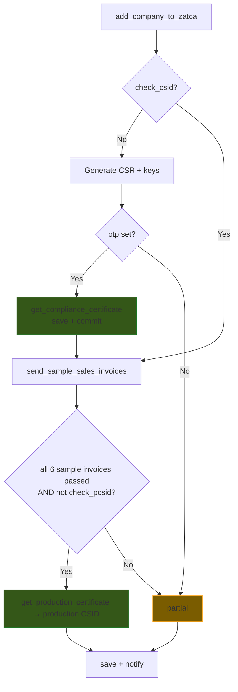
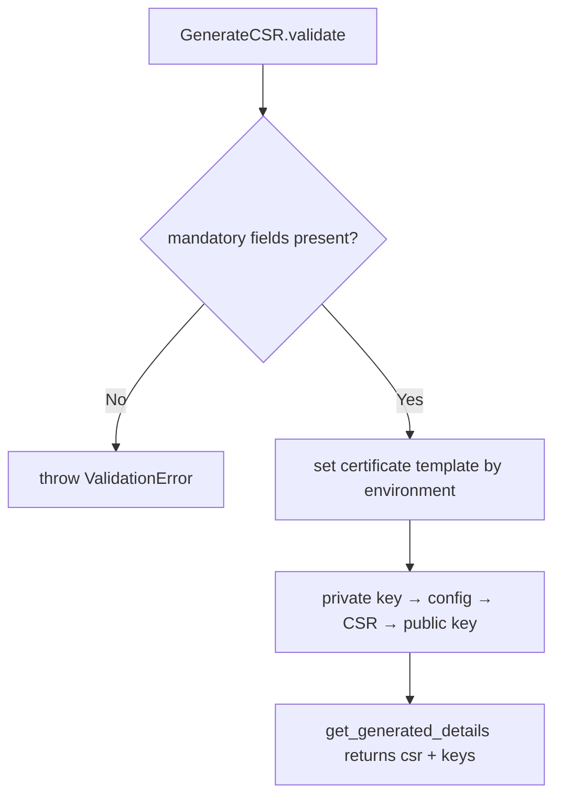

# Onboarding

Developer + power-user reference for **device onboarding** — turning a Commercial Register
into a ZATCA-connected device (CSR → compliance CSID → sample invoices → production CSID).
For the implementer walkthrough, see [user-guide.md](user-guide.md).

The wizard at `/zatca-onboarding` makes one call, `register_company`, which saves each
commercial register and then onboards it. Progress streams back over a realtime channel.

| Entry point | Called by | Does |
|-------------|-----------|------|
| `api.register_company(**payload)` | The wizard's Review step | Validates, saves each register's records, runs `add_company_to_zatca` on each |
| `api.get_companies_registered()` | The wizard, on load | Lists registers that already have a setting, to prefill and block re-adding them |
| `setup.add_company_to_zatca(name)` | Per register, and the setting form's **Setup Zatca** button | The onboarding pipeline below |
| `setup.renew_production_certificate(...)` | The setting form's **Renew Production Certificate** button | [Renewal](#renewal) |

Registration + pipeline: `optima_zatca/zatca/setup.py`
CSR/keys: `optima_zatca/zatca/keys.py` → `GenerateCSR`
Sample invoices: `optima_zatca/zatca/demo.py` → `send_sample_sales_invoices`
ZATCA calls: `optima_zatca/zatca/api.py`, sent through `optima_zatca/zatca/request.py`

---

## Registration

`saving_register_data` writes the company's Arabic name and VAT number onto the **Company**,
the phase onto **Zatca Main Settings**, and then works through the registers one at a time.
Each register owns three records, all keyed on its CRN:

```
CRN 1010101010 → Address "Masar Demo HQ-Billing"
               → Commercial Register "1010101010"
               → Optima Zatca Setting "Masar Demo-1010101010" → add_company_to_zatca
```

Before saving, `_decide_register_action` compares the register with what is already stored for
its CRN. A retry sends the same register again, so this step is what stops it adding a second
set of records:

| Stored for the CRN | Action |
|--------------------|--------|
| Nothing | **save**: create the Address, Commercial Register and setting |
| Records, compliance CSID not yet issued | **save**: update the same records in place, including a newly entered OTP |
| Compliance CSID issued | **resume**: write nothing, run the pipeline from where it stopped |
| Production CSID issued | **refuse**: "already connected to ZATCA" |
| A Commercial Register of another company | **refuse**: "belongs to another company" |

> **Identity is frozen at the compliance CSID.** The register's name, VAT number and address go
> into the CSR, so its records can change only until the compliance CSID is issued. After that
> a retry resumes with them as they are.

A refusal aborts the request. Registers earlier in the same request have already been
onboarded by then.

A setting created here gets two values the wizard does not ask for:

| Field | Value |
|-------|-------|
| `api_endpoints` | The site config key `zatca_onboarding_environment` (`sandbox` or `simulation`), else `production`. Set at creation only; an update leaves it alone |
| `otp` | The OTP entered for the register, or the placeholder `123456` when none was given (the field is mandatory) |

---

## The pipeline

`add_company_to_zatca(name)` loads the **Optima Zatca Setting** identified by `name` and runs
the stages below in order.



Stage by stage:

| # | Stage | Function | Effect |
|---|-------|----------|--------|
| 1 | **CSR + keys** | `GenerateCSR(...).get_generated_details()` | Only while `check_csid` is unset. Creates the private/public key and CSR from the setting's device identity (see below) |
| 2 | **Compliance CSID** | `get_compliance_certificate` → `api.get_zatca_csid` | Submits CSR + OTP to the *compliance* endpoint; stores binary security token, secret, request_id, certificate; sets `check_csid`, and commits at once |
| 3 | **Sample invoices** | `demo.send_sample_sales_invoices` | Submits the six compliance sample invoices, skipping any already accepted; sets `invoice_one … invoice_six` as each passes |
| 4 | **Production CSID** | `get_production_certificate` → `api.get_production_csid` | Runs only when **all six** sample flags are set and `check_pcsid` is unset; stores production token/secret/request_id; sets `check_pcsid` |
| 5 | **Save + notify** | `saving_data_to_setting`, `notify_completion_status` | Writes the collected fields onto the setting, commits, and publishes the final realtime status |

The stage gates are the `check_*` flags on the setting — which is exactly what makes
onboarding **resumable**: a re-run skips whatever is already flagged.

> **Keys are kept once the compliance CSID exists.** That certificate is bound to the key it was
> requested with. Generating a new key on a retry would silently break every later invoice
> signature, so stage 1 runs only before `check_csid` is set.

**Failures.** The whole body is wrapped in a `try/except`. Any failure goes to
`notify_failure_status` (realtime 0%) plus an Error Log row, and is **not raised**, so the next
register in the same request still runs. Whatever was committed before the failure stays saved,
the compliance CSID in particular, and that is what the next retry resumes from.

---

## CSR generation

`GenerateCSR` (`zatca/keys.py`) shells out to **OpenSSL** to produce the key pair and the
certificate signing request. It validates its inputs first, then generates.



**Crypto (ZATCA-mandated):** the private key is **ECDSA on the `secp256k1` curve**
(`openssl ecparam -name secp256k1 -genkey`), the public key is the **compressed** point
(`ec -pubout -conv_form compressed`, used later in the QR), and the CSR is signed **SHA-256**
(`req -new -sha256`). The `default_bits = 2048` line in the generated `config.cnf` is a
vestigial RSA field — it does **not** apply to the EC key.

The CSR subject and subject-alternative-name fields come from three places: the setting
(`get_csr_identity` in `zatca/utils.py`), the run itself (`generate_required_fields`), and the
environment.

| CSR field | Maps to | Source |
|-----------|---------|--------|
| `O` (Organization) | `organization_name` | Setting, falling back to Company `company_name_in_arabic` |
| `OU` (Org. Unit) | `organization_unit_name` | Setting |
| `CN` (Common Name) | `common_name` | Random 15-char hash, generated per run |
| `C` (Country) | — | Fixed `SA` |
| SAN `UID` | `organization_identifier` | Setting, falling back to Company `tax_id` (15-digit VAT) |
| SAN `SN` | `egs_serial_number` | EGS serial, generated per run |
| SAN `title` | `invoice_type` | Setting |
| SAN `registeredAddress` | `address` | Setting's Address, flattened by `format_registered_address` |
| SAN `businessCategory` | `industry` | Setting |
| `certificateTemplateName` | per environment | `sandbox` / `simulation` / `production` each map to their own ZATCA template, with a safe default |

The certificate is issued **per commercial register**, and one company can hold several with
different VAT numbers and different business categories — which is why the setting wins over the
Company. The Company is only a fallback for registers onboarded before those fields were
captured on the setting.

---

## Certificate types

Onboarding yields two certificates, in order — the compliance one gates the production one:

| | Compliance (CSID) | Production (PCSID) |
|---|---|---|
| **Purpose** | Testing & validation (sample invoices) | Live invoice clearance / reporting |
| **Obtained at** | Stage 2, after CSR + OTP | Stage 4, after all sample invoices pass |
| **Setting flag** | `check_csid` | `check_pcsid` |
| **Validity** | ~1 year | ~1 year |

---

## ZATCA calls (`zatca/api.py` → `zatca/request.py`)

`api.py` adds each endpoint's headers and body. `request.py` turns the setting's
`api_endpoints` and the endpoint name into a URL (its `BASEURL` table) and sends the request.

- **No request leaves under tests.** `request.py` throws on any call while `frappe.flags.in_test`.
- **Status handling is in `api.py`.** The certificate calls throw ZATCA's response text on
  anything but HTTP 200. `make_invoice_request` returns the response untouched for its caller
  to judge.
- **Network failures.** Only `make_post_request` turns one into a readable "not responding"
  error; the PATCH helper lets the `requests` exception through.

Onboarding uses the certificate calls below, and `demo.py` sends the sample invoices with
`make_invoice_request` to the `complainace_checks` endpoint. That misspelt key is also stored on
**Optima Zatca Logs** and filtered on by the Zatca Logs report, so renaming it means migrating
those rows.

| Function | ZATCA endpoint | Returns |
|----------|----------------|---------|
| `get_zatca_csid(setting, otp, csr)` | `compliance` | `(request_id, binary_security_token, secret)` — the **compliance** CSID |
| `get_production_csid(setting, token, secret, request_id)` | `onboarding` | The **production** CSID payload (`binarySecurityToken`, `requestID`, `secret`, `tokenType`) |
| `renew_production_csid(setting, otp, authorization, csr)` | `onboarding` | A fresh production CSID (renewal path) |

Both certificate responses are base64 payloads: `_decode_certificate` decodes the binary
security token to the PEM certificate, and `make_auth_header_for_request` (`zatca/utils.py`)
builds the `token:secret` Basic auth header used on later calls.

---

## Realtime progress

Every stage publishes to the **`zatca`** realtime event (`frappe.publish_realtime`), which the
onboarding SPA subscribes to over socket.io. Each event is
`{message, indicator, percentage, complete, commercial_register_name}`. The wizard's progress
board files each one under its `commercial_register_name` and ignores events without one, such
as the "Data Saved Successfully" event `saving_data_to_setting` sends.

Terminal states (`complete` is true):

| Outcome | `percentage` | `indicator` | Message |
|---------|-------------|-------------|---------|
| Full success (`check_pcsid` set) | `100` | green | ZATCA Setup Completed |
| Partial (compliance only) | `50` | red | ZATCA Setup Partially Completed |
| Error (any exception) | `0` | red | ZATCA Setup Failed: … |

Intermediate ticks: CSID created → 20%, each accepted sample invoice → +10% (30–80%), production
CSID created → 95%. A refused certificate request publishes its error at 0% before the terminal
error event.

---

## The two config doctypes

### Optima Zatca Setting

One record **per Commercial Register / device** — the entire onboarding state machine lives
here. Field groups:

| Group | Fields |
|-------|--------|
| **Identity** | `company`, `commercial_register`, `address`, `registration_type` |
| **CSR inputs** | `organization_unit_name`, `invoice_type`, `industry`, plus `address` and `location` — the last two produce `registeredAddress` |
| **Generated by the run** | `common_name`, `egs_serial_number` — read-only; regenerated with the keys (any run before the compliance CSID) and written back by `get_generated_details` |
| **Device identity** | `organization_identifier` (mandatory, validated as a Saudi VAT number) and `organization_name` (read-only, fetched from the company's Arabic name when blank) — these feed both the CSR and the invoice payload's `CompanyID` / `RegistrationName`, with Company as a fallback |
| **Unused** | `country_name` — always `SA`; the CSR config hardcodes `C= SA` and the payload builder uses its own `DEFAULT_COUNTRY_CODE` |
| **Environment** | `api_endpoints` (`sandbox` / `simulation` / `production`, set at creation as in [Registration](#registration)), `phases` (`Phase 1` / `Phase 2`) |
| **Crypto material** | `private_key`, `public_key`, `csr`, `certificate`, `binary_security_token`, `secret`, `request_id`, `production_request_id`, `authorization`, `token_type` |
| **Stage flags** | `check_csr`, `check_csid`, `check_pcsid`, `invoice_one … invoice_six`, `status` (`Not Connected` / `Connected`) |
| **OTP** | `otp` (entered per run; short-lived) |

### Commercial Register

One record **per device/branch** of a company, named by its CRN. The wizard creates it, with
its Address, during [Registration](#registration).

Controller: `optima_zatca/optima_zatca/doctype/commercial_register/commercial_register.py`

| Field | Meaning |
|-------|---------|
| `commercial_register` / `commercial_register_name` | The CR number / display name |
| `company`, `branch`, `address` | Ownership and location |
| `is_main_commercial_register_for_the_company` | Marks the company's primary device |
| `is_default` | Default device for new invoices |
| `disabled` | Excludes the device from selection |

> **One default per company.** The controller rejects a second `is_default` Commercial
> Register for the same company — reuse the existing default rather than creating another.

---

## Renewal

`renew_production_certificate(setting, otp, authorization, csr)` (`zatca/setup.py`) obtains a
fresh production CSID for an already-onboarded device. It needs a **new OTP**, exactly like the
first onboarding, but skips CSR generation and the sample-invoice stage. The setting form's
button sends the setting's own `otp`, `authorization` and `csr`.

> **Renewal is broken.** `api.renew_production_csid` passes `header=` to
> `request.make_patch_request`, whose parameter is `headers`. `make_patch_request` in turn
> passes `header=` to `requests.patch`. Either one raises `TypeError` before anything reaches
> ZATCA.
