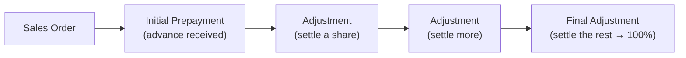

# Prepayment & Adjustment — User Guide

A plain-language guide for accountants to advance-payment invoicing under ZATCA, and to reading
the Advance Payment Report. For the validation rules, the precision model, and the GL handling,
see [reference.md](reference.md).

When a customer pays **in advance**, ZATCA expects a **prepayment invoice** at the time of
payment, and then, as you deliver, **adjustment invoices** that draw that advance down. This
feature models that chain on the Sales Invoice through the **Sales Invoice Type** field.

---

## The invoice types

| Type | When you use it |
|------|-----------------|
| **Normal** | An ordinary sales invoice — no advance involved |
| **Initial Prepayment** | The first advance taken **against a Sales Order** (a Sales Order can have only one) |
| **Prepayment** | A further advance in the same chain |
| **Adjustment** | Settles part of the advance as you deliver, referencing the prepayment |
| **Final Adjustment** | Settles **whatever is left** — its share is filled in for you |

---

## How a prepayment chain works



1. Take the advance with an **Initial Prepayment** invoice against the Sales Order.
2. As you deliver, raise **Adjustment** invoices. Each carries an **adjustment percentage** —
   the share of the advance it settles.
3. Close the chain with a **Final Adjustment**. You don't type its percentage: it's
   **auto-filled and locked** to the remaining share so the whole chain adds up to exactly
   **100%**.

> **The percentages must sum to 100%.** Each adjustment's percentage is checked against how much
> of the advance is left; the Final Adjustment takes the remainder. You can't over-draw a
> prepayment — an adjustment above the remaining share is blocked.

---

## What the system checks

When you save an adjustment invoice, it's validated for you:

- **Required fields** — adjustment percentage, total grands, and grand total must be present.
- **Within range** — the percentage must be between 0% and 100%.
- **Within the remaining limit** — it can't settle more of the advance than is left.
- **Deducted totals** — the deducted grand total can't exceed the invoice's grand total.
- **Payment** — for POS and non-POS invoices, the deducted amount plus what's paid can't exceed
  the grand total.

If any check fails the save is blocked with a message explaining which rule was hit.

## Returns against a prepayment

A return (credit note) tied to a prepayment must reference an **existing** Prepayment Invoice
that **isn't already linked** to another Sales Invoice — this keeps each advance settled once.

---

## Reading the Advance Payment Report

The **Advance Payment Report** answers one question: **how much advance have customers paid that
hasn't been deducted yet?** It groups the invoices into chains and shows what each chain still
holds.

Amounts are **before VAT**, in the company currency. Deductions show in brackets, e.g. (9,000).

### Words the report uses

| Word | Meaning |
|------|---------|
| **Chain** | An Initial Prepayment and every invoice linked after it: Prepayments, Adjustments, the Final Adjustment and any returns. A chain is named after its Initial Prepayment |
| **Prepayment Balance** | Advance received minus advance deducted: what the customer has paid for but not yet received |
| **Open** | The chain has no Final Adjustment yet |
| **Closed** | The chain has a Final Adjustment that hasn't been returned |
| **Remaining %** | 100% minus the percentages already settled |

> **Only a Final Adjustment closes a chain.** A chain whose balance reaches 0 through ordinary
> Adjustments, or whose advance was returned, is still **Open**.

### The dates: To Date is "today", From Date starts the period

Read the report as if you were standing on **To Date**, looking back at the period that starts on
**From Date**.

```
           From Date 1 Apr                         To Date 30 Jun
                 │                                       │
   5 Feb ────────┼───── 15 Apr ─────── 18 Jun ───────────┼───── 8 Sep
   Initial       │      Prepayment     Adjustment        │      Adjustment
   20,000        │      10,000         (9,000)           │      (6,000)
                 │                                       │
   BEFORE        │      INSIDE THE PERIOD                │      AFTER
   counts in the │      this period's new advances       │      ignored, as if it
   opening       │      and deductions                   │      didn't exist yet
```

- **After To Date:** ignored completely. Every chain is shown as it stood on To Date, status
  included: a chain closed on 8 Sep still shows **Open** when To Date is 30 Jun.
- **Before From Date:** still part of the balance. Together these invoices make the chain's
  **opening balance**.
- **Inside the period:** the period's activity, meaning the new advances and the deductions.

### The period balance works like a bank statement

The cards at the top of the report read like a statement:

```
  Opening Advance Balance        what the chains held on From Date
+ Advances Invoiced in Period    new advances (Initial Prepayment, Prepayment) inside the period
− Advances Deducted in Period    deductions (Adjustment, Final Adjustment) inside the period
= Closing Advance Balance        what the chains hold on To Date
```

**Example:** one customer with four chains, and the report run for **1 Apr – 30 Jun 2026**.

| Chain | What happened |
|-------|---------------|
| SINV-0001 | 9,000 advance on 15 Dec 2025; 4,500 deducted on 20 Feb. Nothing since |
| SINV-0002 | 10,000 advance on 12 Jan; 4,000 deducted on 10 Mar; Final Adjustment for the last 6,000 on 20 May |
| SINV-0003 | 20,000 advance on 5 Feb; 10,000 more on 15 Apr; 9,000 deducted on 18 Jun; 6,000 deducted on 8 Sep |
| SINV-0004 | 5,000 advance on 10 Jan; Final Adjustment for all of it on 25 Mar |

What the report shows:

| Chain | Opening (1 Apr) | + Invoiced | − Deducted | = Closing (30 Jun) | Status |
|-------|----------------:|-----------:|-----------:|-------------------:|--------|
| SINV-0001 | 4,500 | 0 | 0 | 4,500 | Open |
| SINV-0002 | 6,000 | 0 | 6,000 | 0 | Closed |
| SINV-0003 | 20,000 | 10,000 | 9,000 | 21,000 | Open |
| **Cards** | **30,500** | **10,000** | **15,000** | **25,500** | **Open Chains: 2 of 3** |

- **SINV-0001** had no invoice in the period. It counts because it still **held 4,500 on 1 Apr**.
- **SINV-0002** closed **inside** the period, so it shows as Closed, with its last deduction.
- **SINV-0003** includes its 15 Apr advance and its 18 Jun deduction. Its 8 Sep deduction is
  **after To Date**, so it's left out.
- **SINV-0004** was **fully settled before 1 Apr** and had nothing in the period, so it isn't shown.

> **Which chains appear?** A chain appears if it **still held an advance on From Date**, or has
> **at least one invoice inside the period**. Any other chain is left out of the list, the cards
> and the chart.

### The chain line (Full Chain)

In the **Full Chain** approach, each chain gets a shaded summary line with its invoices under it:

```
 Invoice       Date     Type                 Prepayment Amount   Prepayment Balance   Status
 SINV-0003     5 Feb    Chain                           21,000               21,000   Open
   SINV-0003   5 Feb    Initial Prepayment              20,000               20,000   (faded)
   SINV-0010   15 Apr   Prepayment                      10,000               30,000
   SINV-0014   18 Jun   Adjustment                      (9,000)              21,000
```

- Invoices before From Date are still listed, **faded**, so you can see where the opening
  balance came from. Invoices after To Date are not listed.
- Each invoice line's **Prepayment Balance** is the chain's balance just after that invoice.
- The chain line adds up **every invoice up to To Date**, not only the period's. That's why its
  Prepayment Amount always equals its balance: 20,000 + 10,000 − 9,000 = 21,000. What this chain
  moved in the period alone (10,000 − 9,000 = +1,000) is counted in the cards.
- **Days Since Last Invoice** counts from the chain's last invoice to To Date; it's blank once the
  chain is Closed. **Chain Period** is the number of days from its first invoice to its last.

### The approaches change the list, not the totals

| Approach | The list shows |
|----------|----------------|
| **Full Chain** | Every chain, each with all its invoices up to To Date |
| **Prepayment** | Only Initial Prepayment and Prepayment invoices dated inside the period |
| **Adjustment** | Only Adjustment and Final Adjustment invoices dated inside the period |
| **Single Type** | Only the Invoice Type you pick, dated inside the period |

**The cards and the chart are the same in every approach.** In the example:

| Approach | Invoices listed |
|----------|-----------------|
| Full Chain | SINV-0001, SINV-0002 and SINV-0003, each with all its invoices up to 30 Jun |
| Prepayment | The 15 Apr Prepayment (10,000) |
| Adjustment | The 20 May Final Adjustment (6,000) and the 18 Jun Adjustment (9,000) |
| Single Type: Final Adjustment | The 20 May Final Adjustment |

- The Prepayment list adds up to the **Advances Invoiced** card (10,000). The Adjustment list adds up
  to the **Advances Deducted** card (15,000).
- SINV-0001 gets no line in these lists, because nothing happened in the period. Its 4,500 is still
  in the **Opening** card.
- In these lists the **Prepayment Balance** is still the chain's balance after that invoice. So it
  includes what happened before From Date: the 15 Apr Prepayment shows 30,000, not 10,000.

### The Status filter

- **Open** or **Closed** keeps only the chains in that state **on To Date**. The cards and the
  chart change with it.
- **Closed** lists the chains that closed inside the period. A chain settled earlier holds nothing
  on From Date, so it doesn't appear. Move From Date back to see it.

### Things that surprise people

- **Balance 0 but Open.** The advance was used up by ordinary Adjustments, or it was returned.
  Only a Final Adjustment closes a chain. Such a chain also drops out of later periods that have no
  invoice for it, because it holds nothing on their From Date.
- **Returning a Final Adjustment reopens the chain.** The returned share goes back into the
  balance.
- **The chart isn't limited to the period.** It shows the customers holding the most advance on
  To Date, and its **Deducted to Date** bar includes deductions from before From Date.
- **Cost Center and Project filters.** A chain counts if any of its invoices matches, so the cards
  include its whole period. The lists only show the invoices that match themselves, so their
  totals can come out lower than the cards.
- **Timespan** (This Week, This Month, This Quarter, This Year) just fills From Date and To Date.
  Change either date yourself and the Timespan clears.
